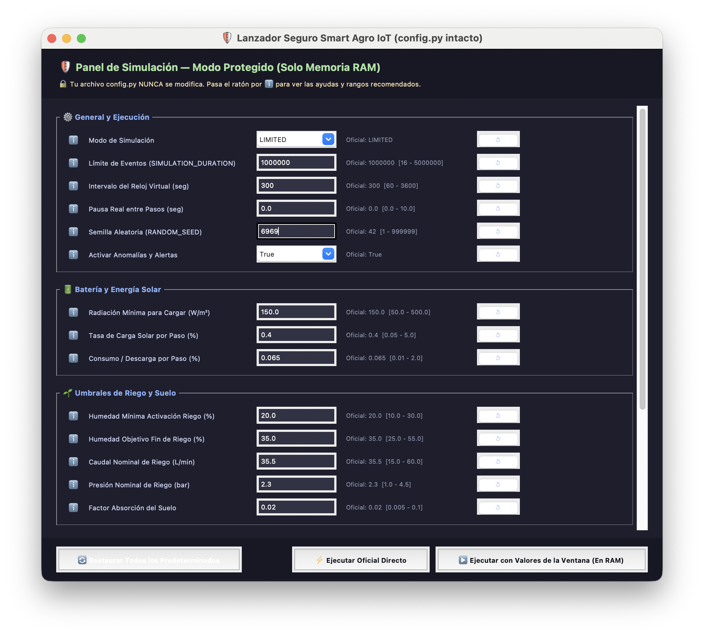
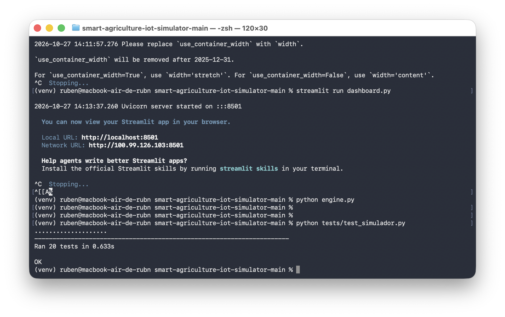
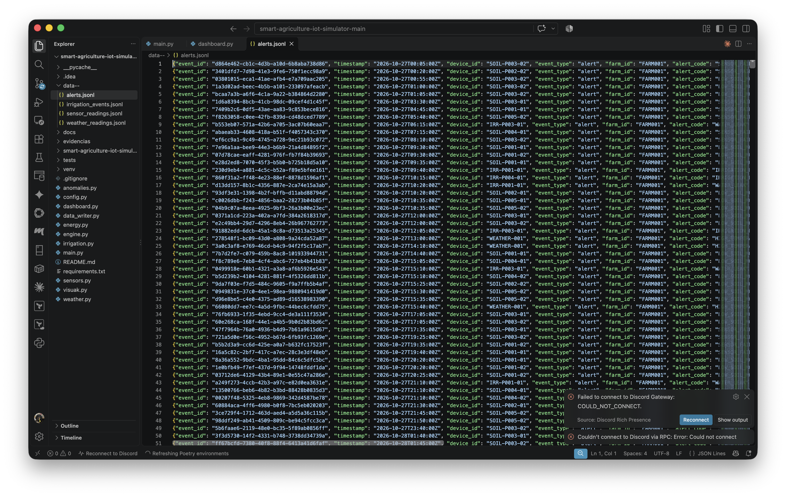
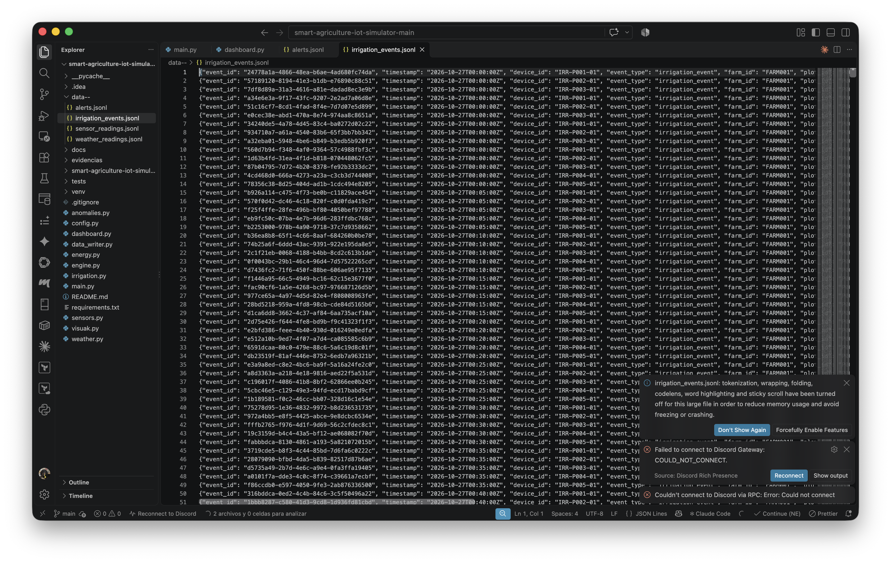
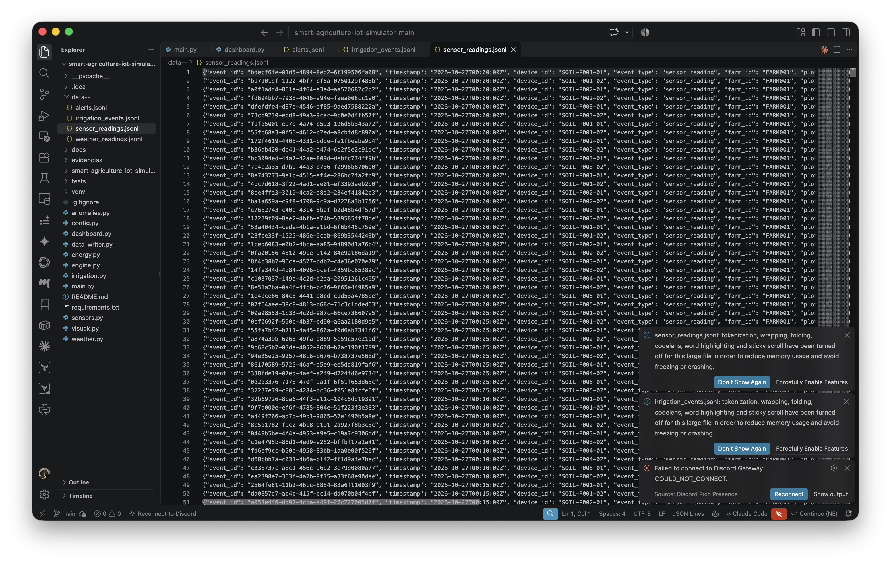
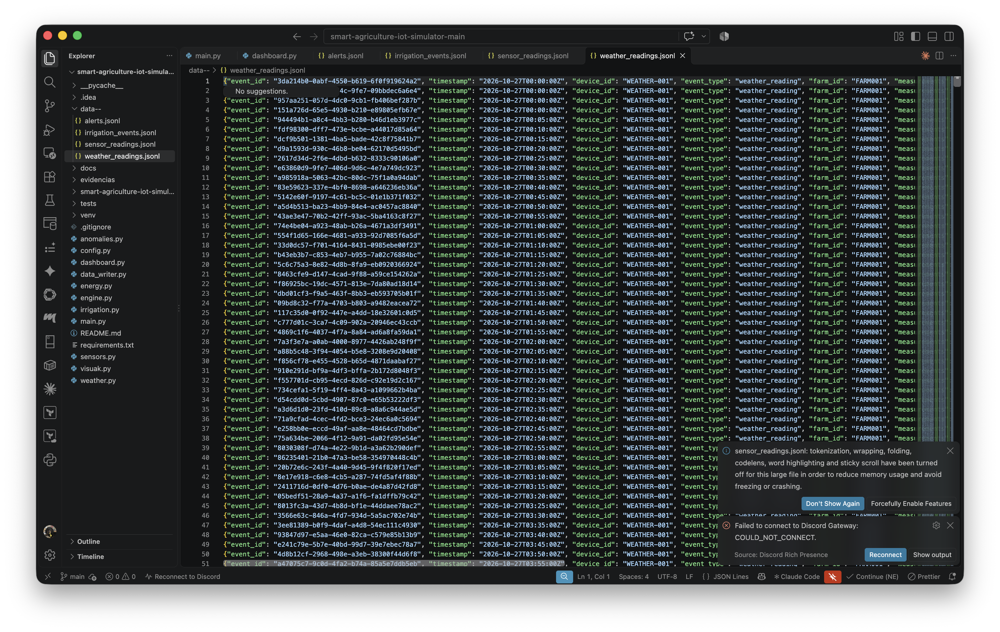
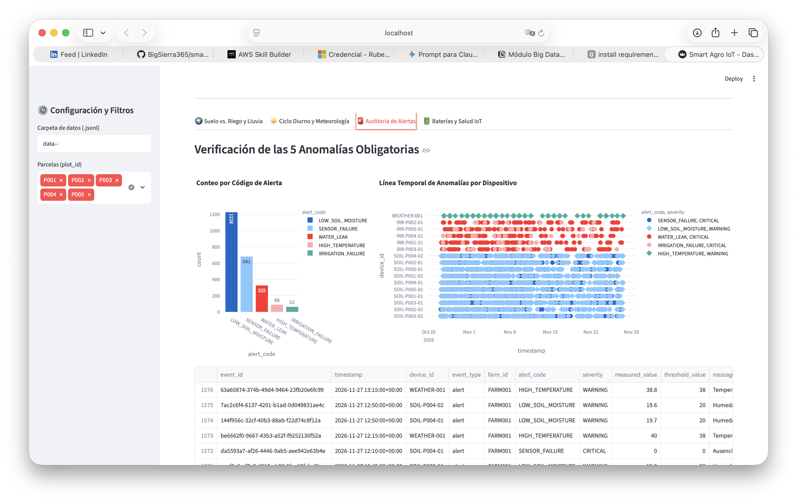

# Evidencias — Smart Agriculture IoT Simulator

Capturas del 27/10/2026 que demuestran que el simulador funciona de extremo a extremo: configuración, ejecución, pruebas, datos generados y dashboard.

## 1. Lanzador seguro (configuración)

Panel de simulación en modo protegido: `config.py` no se modifica y los valores se pasan solo en RAM. Parámetros visibles: modo `LIMITED`, 1.000.000 eventos, intervalo de reloj virtual de 300 s, semilla aleatoria 6969 (la oficial es 42) y anomalías activadas. Incluye umbrales de riego (20 % / 35 %), caudal 35,5 L/min y presión 2,3 bar.

## 2. Ejecución y tests

- `python engine.py` ejecuta el simulador.
- `streamlit run dashboard.py` levanta el dashboard en `http://localhost:8501`.
- `python tests/test_simulador.py` termina con **Ran 20 tests ... OK**.

## 3. Datos generados (`data--/`)

| Fichero | Captura | Contenido |
|---|---|---|
| `alerts.jsonl` |  | Eventos `alert` por dispositivo (SOIL, IRR, WEATHER) |
| `irrigation_events.jsonl` |  | Eventos `irrigation_event` de IRR-P001..P005 cada 5 min |
| `sensor_readings.jsonl` |  | Eventos `sensor_reading` de SOIL-Pxxx-01/02 |
| `weather_readings.jsonl` |  | Eventos `weather_reading` de WEATHER-001 |

Todos usan timestamps cada 5 min desde `2026-10-27T00:00:00Z` y `farm_id` `FARM001`.

Número de líneas:

| Fichero | Líneas |
|---|---|
| `sensor_readings.jsonl` | 136.336 |
| `irrigation_events.jsonl` | 68.167 |
| `weather_readings.jsonl` | 13.636 |
| `alerts.jsonl` | 2.382 |

## 4. Dashboard: auditoría de alertas

Pestaña «Auditoría de Alertas», con las 5 anomalías obligatorias detectadas:

| Código | Conteo |
|---|---|
| `LOW_SOIL_MOISTURE` | 1226 |
| `SENSOR_FAILURE` | 681 |
| `WATER_LEAK` | 325 |
| `HIGH_TEMPERATURE` | 88 |
| `IRRIGATION_FAILURE` | 62 |

Incluye también la línea temporal por dispositivo y la tabla de eventos (p. ej. `HIGH_TEMPERATURE` 38,8 frente a un umbral de 38).
